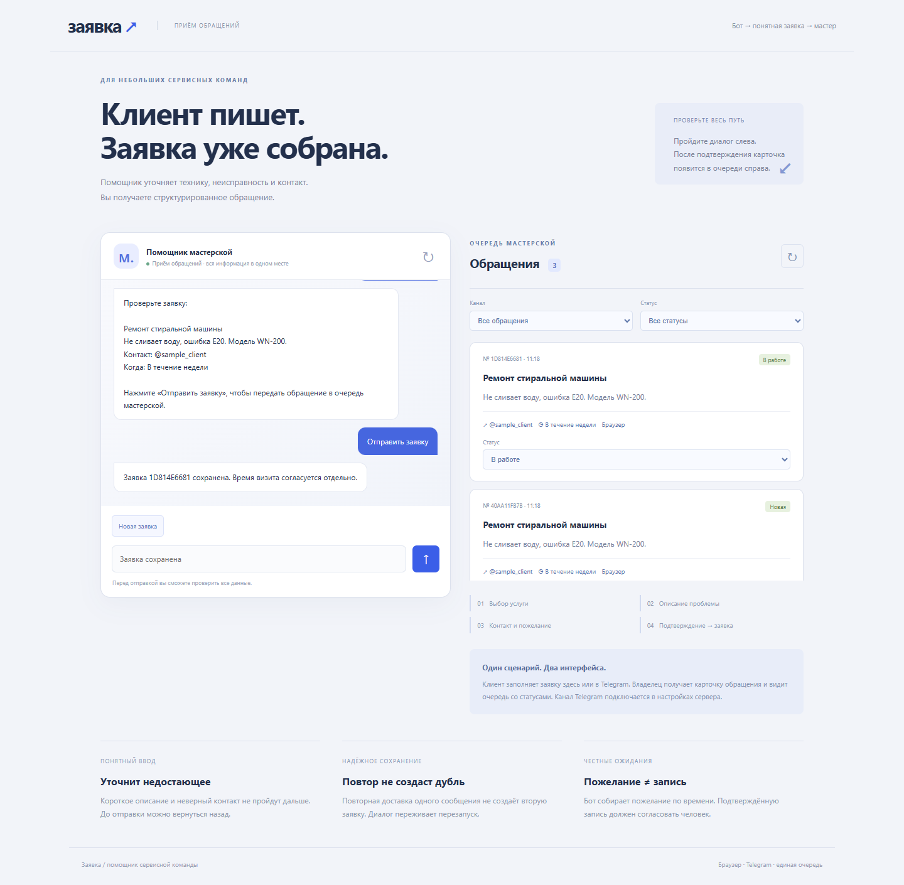

# Заявка — бот приёма обращений

Pet-проект для портфолио: приём заявки в браузере и подготовленное подключение к Telegram.



## Что делает

Собирает технику, описание неисправности, контакт и пожелание по времени. Перед отправкой показывает итог. Проверяет ввод, позволяет вернуться назад и начать заново, сохраняет диалог и заявки в SQLite. Владелец видит очередь с источником и статусами «Новая», «В работе», «Завершена».

При повторной обработке одного сообщения заявка не создаётся второй раз. Пожелание по времени не является подтверждённой записью.

## Просмотр без Telegram

Запустите `python app.py`, откройте http://127.0.0.1:8766 и пройдите диалог. После подтверждения карточка появится справа. Здесь не нужны токен, личный аккаунт Telegram или внешний API. Этот режим не отправляет внешних уведомлений.

## Куда уходит заявка в настоящем Telegram

1. Клиент пишет боту.
2. Программа получает сообщение через Telegram Bot API и использует тот же сценарий диалога.
3. Подтверждённая заявка сохраняется в `runtime/requests.sqlite3`.
4. Бот отправляет владельцу сообщение в чат, указанный в `TELEGRAM_OWNER_CHAT_ID`: номер, техника, проблема, контакт и пожелание по времени.
5. Владелец может написать `/requests`, `/take НОМЕР` или `/done НОМЕР`. Эти команды доступны только настроенному чату владельца.
6. Браузерная очередь показывает ту же базу. Достаточно запустить `app.py` рядом с Telegram-процессом и обновить очередь. Разделять файлы баз по умолчанию не требуется.

В очередь уведомлений попадают только обращения из Telegram. Заявки браузерного режима не отправляются владельцу автоматически.

## Подключение Telegram

Telegram-адаптер использует long polling. Доставка, команды владельца, повторная обработка и сбои покрыты автоматическими тестами с подменой транспорта. Интеграция с действующим Telegram API отдельно не проверялась.

Создайте бота в BotFather. Задайте `TELEGRAM_BOT_TOKEN` и числовой `TELEGRAM_OWNER_CHAT_ID` через переменные окружения, начните диалог с ботом из чата владельца, затем запустите:

```text
python run_telegram.py
```

При необходимости у обоих процессов можно явно указать один и тот же файл:

```text
python app.py --database runtime/requests.sqlite3
python run_telegram.py --database runtime/requests.sqlite3
```

Обработка сообщений выполняется процессом `run_telegram.py`; при его остановке получение новых сообщений и отправка уведомлений приостанавливаются. Настройки Telegram читаются сервером из переменных окружения.

Адаптер не удаляет активный webhook. При сбое между внешней отправкой и фиксацией доставки уведомление может повториться; повторная запись самой заявки защищена отдельно. Сохранённые заявки останутся в базе, даже если Telegram временно недоступен. Ошибки транспорта не печатают URL с токеном.

Документация API: https://core.telegram.org/bots/api .

## Структура

```text
app.py                 браузерный интерфейс и API очереди
engine.py              диалог, хранение, статусы и очередь уведомлений
run_telegram.py        запуск Telegram-процесса
telegram_client.py     HTTP-клиент Telegram
telegram_service.py    маршрутизация, уведомления, команды владельца
local_server.py        локальный сервер
web/                   диалог и очередь
tests/                 сценарии и проверки Telegram-транспорта
```

Служебная очередь локальная и пока без авторизации. Показаны последние 100 обращений; `/requests` выводит последние 10 Telegram-заявок. Платежи, календарь и LLM не подключены.

## Разработка

Требуется Python 3.10+. Сторонних зависимостей для запуска нет.

```text
python app.py
python -m unittest discover -s tests -v
```

На Windows можно запустить `START.cmd` или использовать `py -3` вместо `python`. Остановка сервера — Ctrl+C. Для другого порта: `python app.py --port 8780`.

HTTP-сервер слушает только `127.0.0.1`. Приложение рассчитано на локальный запуск.

В `.github/workflows/tests.yml` настроен запуск тестов на Python 3.10 и 3.12. Результаты локальных проверок — в [TESTING.md](TESTING.md).

Лицензия MIT.
